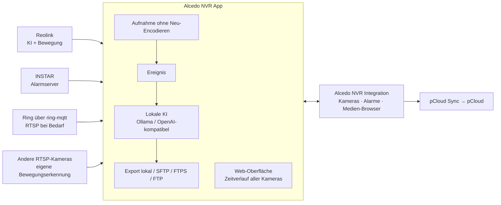

<div align="center">


# Alcedo NVR

**Schlanker, lokaler NVR für Home Assistant – mit lokaler KI, die jeden Alarm prüft.**

[🇬🇧 English](README.md) · 🇩🇪 Deutsch

</div>

Alcedo (lat. Eisvogel) nimmt deine **Reolink-**, **INSTAR-**, **Ring-** (über RTSP) und sonstigen **RTSP-Kameras** auf. Ein **lokales Vision-Sprachmodell** prüft jeden Alarm, und bestätigte Alarme landen automatisch **lokal**, per **SFTP/FTPS/FTP** oder über [pCloud Sync](https://github.com/DASO203/pcloud-sync-unofficial) in **pCloud**.

Alcedo läuft als **App** (früher Add-on) auf deinem Home-Assistant-Rechner. Eine extra VM ist nicht nötig.

## Aufbau



| Repo | Inhalt | Installation |
|---|---|---|
| **alcedo-nvr** (dieses) | die App: Aufnahme, Erkennung, KI, Export, Weboberfläche | Einstellungen → Apps → Repository hinzufügen |
| [alcedo-nvr-integration](https://github.com/DASO203/alcedo-nvr-integration) | die Integration: Entitäten, Events, Medien, pCloud-Übergabe | Marketplace |

## Funktionen

- 🎥 **Aufnahme 1:1** (`-c copy`), keine CPU-Last durch Neu-Encodieren. Modi: nur Ereignisse (mit Vorlauf), dauerhaft, **bei Bedarf** (Ring/Akku-Kameras) oder aus.
- 🚨 **Alarmquellen:** Reolink-Kamera-KI (Person/Fahrzeug/Tier) und Bewegung, INSTAR-Alarmserver, eigene schlanke Bewegungserkennung, jeder Home-Assistant-Sensor über `alcedo_nvr.trigger`.
- 🧠 **Lokale KI-Prüfung:** Du beschreibst in Alltagssprache, was ein Alarm ist. Das Modell bewertet die Bilder und liefert einen kurzen Satz („Eine Person steht am Gartentor“).
- 🕒 **Zeitverlauf aller Kameras:** Tagesansicht mit Aufnahmebalken und Alarm-Markierungen. Ein Klick spielt ab dieser Stelle ab.
- 📤 **Export:** lokal (z. B. als Sync-Ordner für pCloud Sync), SFTP (Hostschlüssel-Prüfung), FTPS, FTP.
- 🧹 **Speicherverwaltung:** Aufbewahrung in Tagen **und** maximale Plattenbelegung.
- 🔐 **Sicher:** API nur mit Zufallsschlüssel, Oberfläche nur über die Anmeldung von Home Assistant, Passwörter werden aus Logs entfernt, keine Cloud, keine Telemetrie.

## Installation

1. **Einstellungen → Apps → App-Store → ⋮ → Repositories** → `https://github.com/DASO203/alcedo-nvr` hinzufügen
2. **Alcedo NVR** installieren. Der erste Start baut das Image lokal und dauert ein paar Minuten.
3. Tab **Konfiguration**: Kameras eintragen (siehe unten) → **Starten**
4. Die **Integration** [Alcedo NVR](https://github.com/DASO203/alcedo-nvr-integration) über den Marketplace installieren. Home Assistant findet die App automatisch („Neues Gerät gefunden“).

### Speicher

Aufnahmen gehören auf eine große Platte bzw. ein NAS. In Home Assistant: **Einstellungen → System → Speicher → Netzwerkspeicher hinzufügen**, Verwendung **Medien**, z. B. Name `nvr` → `storage_path: /media/nvr/alcedo`. Den Ordner aus den Backups ausschließen.

## Kameras

```yaml
- name: Einfahrt
  type: reolink
  host: 192.168.1.20
  username: admin
  password: geheim
  objects: person, vehicle
- name: Garten
  type: instar
  host: 192.168.1.21
  username: admin
  password: geheim
  detect: both
- name: Haustür Ring
  type: ring
  rtsp_main: rtsp://03cabcc9-ring-mqtt:8554/0123456789ab_live
```

**Reolink:** In der Kamera HTTPS (oder HTTP mit `use_https: false`) und RTSP aktivieren. Am besten einen eigenen Benutzer anlegen.

**INSTAR:** In der Kamera unter *Alarm → Alarmserver* eintragen:
- Server: IP von Home Assistant, Port `8765`
- Pfad: `/api/hook/instar/garten`
- Parameter `token`: API-Key (steht in der Alcedo-Oberfläche unter „Verbindung für die Integration“)
- „Alarmauslöser an Anfrage anhängen“ aktivieren

**Ring:** Ring bietet kein lokales RTSP. Die App **ring-mqtt** stellt pro Kamera einen RTSP-Stream bereit (Attribut `stream_source` des *Info*-Sensors). Alcedo nimmt Ring-Kameras nur **bei Bedarf** auf. Das schont Akku und Ring-Kontingent, dafür gibt es keinen Vorlauf. Ausgelöst wird über Home Assistant:

```yaml
triggers:
  - trigger: state
    entity_id: binary_sensor.haustuer_motion
    to: "on"
actions:
  - action: alcedo_nvr.trigger
    data:
      entity_id: camera.haustuer_ring
      label: person
```

Alle Felder und Optionen stehen in der [DOCS.md](alcedo_nvr/DOCS.md). Die erscheint auch im App-Tab **Dokumentation**.

## Lokale KI

1. Einen Ollama-Server bereitstellen, z. B. als App aus einem Community-Repository oder Ollama auf einem anderen Rechner im Netz.
2. Ein **kleines Vision-Modell** laden, z. B. `qwen2.5vl:3b`, `gemma3:4b` oder `moondream`.
3. In Alcedo:
   ```yaml
   llm_enabled: true
   llm_url: http://172.30.32.1:11434
   llm_model: qwen2.5vl:3b
   llm_prompt: "Alarm nur bei Personen oder fremden Fahrzeugen. Katzen, Vögel, Schatten, Regen und Scheinwerfer ignorieren."
   ```

Auf einem Mini-PC der N100-Klasse dauert eine Prüfung auf der CPU grob einige zehn Sekunden (Schätzung, abhängig von Modell, Bildanzahl und RAM). Der Alarm selbst kommt sofort, das KI-Urteil folgt. Antwortet die KI nicht, gilt der Alarm als **bestätigt** (sicherer Ausfallmodus). Neben Home Assistant und einem LLM sind **16 GB RAM** empfehlenswert.

## pCloud

Zwei Wege, beide mit [pCloud Sync](https://github.com/DASO203/pcloud-sync-unofficial):

1. **Direkt (empfohlen):** In der Alcedo-Integration unter **Konfigurieren** → „Nach pCloud hochladen: nur bestätigte Alarme“ wählen. Clip und Snapshot landen in `…/alcedo/<kamera>/`.
2. **Über den Export-Ordner:** `export_local_path` (Standard `/media/alcedo/export`) in pCloud Sync als überwachten Ordner eintragen, optional mit „lokal nach Upload löschen“.

## Lizenz

MIT – kein offizielles Produkt von Reolink, INSTAR, Ring, Ollama oder pCloud.
